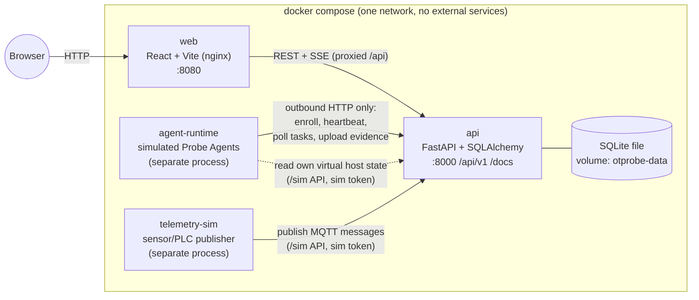
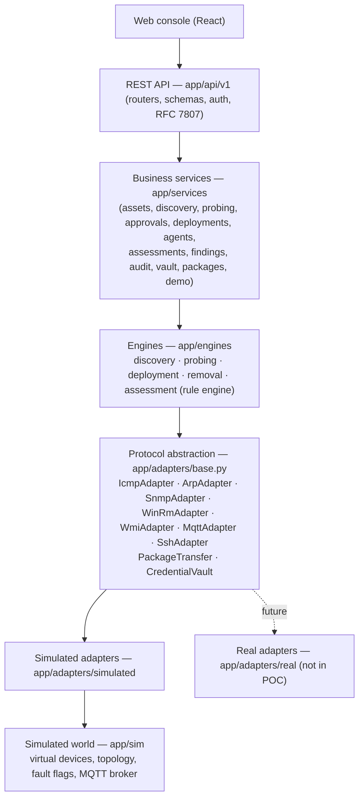

# OTProbe — Architecture

> Status: complete (Phases 1–5). The decisions made during the build are in [DECISIONS.md](DECISIONS.md).
>
> **Live network redesign in progress:** see [LIVE_ARCHITECTURE.md](LIVE_ARCHITECTURE.md). This document describes the simulated POC, which is kept on the `simulated` branch. On `main` the simulator exists only inside the test suite (`backend/tests/sim`, phase L6).
>
> OTProbe is a standalone proof-of-concept for **OT asset discovery, agentless probing and deep agent probing**.
> The OT network, its devices and every protocol response are **simulated**. The web console, REST API,
> database, workflows, approvals, compliance rules, findings and audit trail are **real**.

Related design documents:

| Document | Contents |
|---|---|
| [DATA_MODEL.md](DATA_MODEL.md) | ERD, tables, key constraints, retention |
| [ADAPTERS.md](ADAPTERS.md) | Protocol adapter interfaces, contract tests, replacing simulated adapters with real ones |
| [PROVENANCE.md](PROVENANCE.md) | Field provenance model and the provenance matrix |
| [STATE_MACHINES.md](STATE_MACHINES.md) | All state machines, allowed transitions, audit event names |
| [FAILURE_MATRIX.md](FAILURE_MATRIX.md) | Every injectable failure: resulting state, UI message, audit event, recovery |
| [RULES.md](RULES.md) | Compliance rule schema, condition language, evaluation order, scoring formula |
| `SIMULATED_NETWORK.md` (on the `simulated` branch) | Seed devices, topology, per-protocol behaviour |
| [api/openapi.yaml](api/openapi.yaml) | OpenAPI 3.1 contract draft for `/api/v1` |

---

## 1. Safety guarantees

OTProbe never touches a real network. This is enforced **structurally**, not just by convention:

1. **No real adapters ship in the POC.** The adapter registry only knows `simulated` implementations. Setting
   `ADAPTER_MODE=real` fails at startup with `No real adapter registered for protocol 'icmp'`.
2. **Simulated adapters cannot do network I/O.** A test (`test_sim_adapters_have_no_network_imports`) fails the
   build if any module under `app/adapters/simulated/` or `app/sim/` imports `socket`, `subprocess`, `scapy`,
   `pysnmp`, `pywinrm`, `paramiko`, `asyncio.open_connection` or other network or process primitives.
3. **Targets are keys, not addresses.** `192.168.20.0/24` is looked up in the simulated network model. A target
   that does not exist in the model returns "no hosts" and is never resolved or routed.
4. **The only real HTTP traffic** is between OTProbe's own containers on the Compose network (console → API,
   agent runtime → API, telemetry simulator → API).
5. **All credentials are synthetic** (`demo\agent-installer`, etc.). Secrets are masked (`••••••••`) in every
   API response and UI view. Raw secret values are never logged.
6. **Persistent banner** on every console screen: `SIMULATED ENVIRONMENT - NO REAL DEVICES ARE BEING SCANNED`.
   The API also adds an `X-OTProbe-Environment: SIMULATED` header to every response.

---

## 2. Runtime view (`docker compose up`)



| Container | Process | Responsibility |
|---|---|---|
| `web` | nginx serving the Vite build; proxies `/api` to `api` | Console UI. Holds no state of its own: everything comes from the API. |
| `api` | uvicorn (single worker; see §8) | REST API, business services, engines, adapters, **simulated world**, in-process MQTT broker, job runner, SSE hub, heartbeat watchdog, assessment scheduler |
| `agent-runtime` | Python asyncio supervisor | Runs one simulated Probe Agent per virtual host on which an agent has been "installed". Every agent talks to the API **outbound only**, over HTTP. |
| `telemetry-sim` | Python asyncio loop | Generates deterministic sensor/PLC telemetry (driven by `SEED`) and publishes it to the in-process broker |
| (volume) | `otprobe-data:/data/otprobe.db` | SQLite DB; survives `docker compose down` / `up`. Alembic migrations run on `api` start. |

The server never opens a connection to `agent-runtime` or `telemetry-sim`. Both can be killed and restarted
on their own, and the server notices only through missing heartbeats or missing telemetry.

---

## 3. Layering (mandatory)



Rules enforced by import-linter contracts (`backend/.importlinter`, checked in CI):

| Layer | May import | Must NOT import |
|---|---|---|
| `app.api` | `app.services`, `app.schemas`, `app.core` | `app.engines`, `app.adapters`, `app.sim`, `app.models` (only through services) |
| `app.services` | `app.engines`, `app.models`, `app.core`, `app.adapters.base` | `app.adapters.simulated`, `app.sim` |
| `app.engines` | `app.adapters.base`, `app.models`, `app.core`, `app.rules` | `app.adapters.simulated`, `app.sim` |
| `app.adapters.simulated` | `app.adapters.base`, `app.sim` | `app.services`, `app.engines` |
| `app.sim` | `app.core` | everything above it |
| `app.api.sim` (simulator-facing routes) | `app.sim` | `app.services` |

The engines receive adapters through `AdapterRegistry.get(Protocol.WINRM)`, which reads `ADAPTER_MODE` /
`ADAPTER_OVERRIDES`. Business code cannot tell whether an adapter is simulated. Simulated-ness is reported only
through the adapter's `descriptor().simulated`, which the UI uses for the `SNMP (Demo)` style labels.

### 3.1 Module map (backend)

```
backend/app/
  main.py                composition root: the ONLY module that wires app.sim + simulated adapters into the app
  core/                  config (env), security (JWT, hashing), correlation, errors, idempotency, sse hub, clock
  api/v1/                routers: auth, assets, discovery, probes, deployments, approvals, agents, agent-facing,
                         assessments, findings, telemetry, topology, audit, vault, packages, demo, settings, events
  api/sim/               simulator-facing routes (/sim/*), separate auth, NOT business API
  schemas/               Pydantic request/response models (OpenAPI source of truth)
  models/                SQLAlchemy 2 ORM models
  services/              business services (transactions, RBAC checks, audit writing, state machines)
  engines/
    discovery/           progressive multi-method discovery, merge-by-MAC, rogue detection
    probing/             agentless probe plan + step execution, classification, eligibility
    deployment/          precheck, deploy steps, enrollment token minting
    removal/             rollback steps
    assessment/          rule loader, condition parser, evaluator, scoring, drift, findings reconciliation
  workflow/              generic persisted state machine + step runner (used by all long-running jobs)
  context.py             AppContext: settings, db, SSE hub, adapter registry, vault, job runner, rule book
  adapters/
    base.py              protocol interfaces + result types   (Phase 1 deliverable)
    registry.py          config-driven adapter selection
    simulated/           one module per protocol
  sim/                   simulated world: device model, seed, topology, fault injection, MQTT broker
  rules/                 (python) loader/validator for /rules data files
```

---

## 4. The simulation boundary

There are two separate stores of truth, and keeping them apart is what makes the demo honest:

| | **Simulated world** (`sim_*` tables, `app/sim`) | **OTProbe knowledge** (all other tables) |
|---|---|---|
| Represents | The physical plant: what is *actually* on the wire and on each host's disk | What OTProbe has *observed*, with provenance |
| Written by | Seed, Demo Controls, simulated adapters with side effects (WinRM install/uninstall) | Business services only |
| Read by | Simulated adapters, `/sim` API (agent runtime, telemetry sim) | API, UI |
| Reset by | Reset POC | Reset POC |

Business services **never** read `sim_*` tables. An asset's OS is unknown until a probe reports it, even though
the simulator "knows" it. Demo Controls change the world (for example "disable firewall"). OTProbe only notices
on its next probe or assessment, as a real product would.

### 4.1 `/sim` API (simulator-facing, not part of the product)

This API stands in for physics: a host's local disk and registry, and the plant's MQTT clients. It lives under
`/sim/v1`, is tagged `simulator-internal` in OpenAPI, and requires the `SIM_SERVICE_TOKEN` header. The console
never calls it. Demo Controls go through the real `/api/v1/demo/*` endpoints, which are admin-only and audited.

| Endpoint | Caller | Real-world equivalent |
|---|---|---|
| `GET /sim/v1/hosts/agent-installs` | agent-runtime | "Which machines have the agent service installed and set to run?" |
| `GET /sim/v1/hosts/{deviceId}/local-state` | agent (inside runtime) | Agent reading local OS state: registry, WMI, `netsh`, `Get-LocalGroupMember`, … |
| `GET /sim/v1/hosts/{deviceId}/install-bundle` | agent | Reading `C:\ProgramData\OTProbe\enroll.json` written by the installer |
| `GET /sim/v1/telemetry/sources` | telemetry-sim | Sensors' physical state (current setpoints, injected overrides) |
| `POST /sim/v1/mqtt/publish` | telemetry-sim | A sensor/PLC publishing to the broker |

---

## 5. Agent model

```mermaid
sequenceDiagram
  autonumber
  participant Op as Operator (console)
  participant API as OTProbe API
  participant WR as WinRM adapter (sim)
  participant VH as Virtual host eng-ws-01
  participant RT as agent-runtime
  Op->>API: POST /deployments/{id}/deploy
  API->>WR: open_session / transfer_package / run_install
  WR->>VH: mutate state: files, service "OTProbeAgent" created+started, enroll.json (token)
  API-->>Op: SSE deployment.step … status ENROLLING
  loop every 2s (scaled)
    RT->>API: GET /sim/v1/hosts/agent-installs
  end
  RT->>RT: spawn Agent(eng-ws-01)
  RT->>API: GET /sim/v1/hosts/{id}/install-bundle  (reads token from "disk")
  RT->>API: POST /api/v1/agents/enroll {enrollmentToken, hostFingerprint}
  API-->>RT: {agentId, agentCredential}   (token consumed; credential stored hashed)
  loop every HEARTBEAT_INTERVAL_SEC
    RT->>API: POST /api/v1/agents/{id}/heartbeat  (Bearer agentCredential)
    RT->>API: GET /api/v1/agents/{id}/tasks?wait=…  (long-poll)
  end
  API-->>RT: task: RUN_ASSESSMENT(policy=Windows Engineering Baseline)
  RT->>API: GET /sim/v1/hosts/{id}/local-state
  RT->>API: POST /api/v1/agents/{id}/tasks/{taskId}/evidence
```

- **Outbound only.** The agent starts every exchange. Tasks are delivered by **long-polling**
  (`GET …/tasks?waitSec=20`): the server holds the request until a task arrives or the wait expires.
- **Independent of the deployment.** Once the install bundle exists on the virtual host, the agent-runtime
  starts the agent whether or not the deployment request is still in progress. Deployment `ENROLLING → COMPLETED`
  happens when the server sees the first successful heartbeat after enrollment, or `FAILED` on timeout
  (`ENROLLMENT_TIMEOUT_SEC`, default 120 × `SPEED_FACTOR`).
- **The agent's checks run on its own host.** Each agent reads only its own host's `local-state` (the sim token
  is scoped per deviceId in the bundle). It applies the policy's *collectors*: it collects evidence, it does not
  judge it. **Evaluation (PASS/FAIL) happens on the server**, so the rules stay data and stay auditable.
- **Fault flags** that the agent obeys come from `local-state.faults`: `heartbeat_blocked` (the network path
  drops its packets), `agent_crashed` (the process exits and the runtime does not restart it until the service is
  restarted), `assessment_timeout` (the agent accepts the task but never uploads).
- **Credential lifecycle**: enrollment token (single-use, 15-min TTL, SHA-256 hashed, bound to asset +
  deployment) → agent credential (random 256-bit, stored as SHA-256, prefix shown for identification).
  Removal or "revoke" sets `revoked_at`. Any later call with that credential returns `401` + RFC 7807
  `agent-credential-revoked`, and the agent process exits.

---

## 6. Long-running work: the workflow runner

Discovery jobs, agentless probes, prechecks, deployments, removals and assessments are all **persisted
workflows**:

- One row per workflow (`discovery_jobs`, `probe_runs`, `deployments`, …) with a `status` driven by an explicit
  state machine (see [STATE_MACHINES.md](STATE_MACHINES.md)), plus child **step rows** (`workflow_steps`) with
  `name, status (PENDING/RUNNING/OK/FAILED/SKIPPED), detail, progress, started_at, finished_at`.
- Every transition goes through `StateMachine.transition(entity, to, actor, reason)`. That call rejects invalid
  edges (`409 invalid-state-transition`), writes the audit event and publishes an SSE event, **in the same DB
  transaction** (the SSE publish happens after commit).
- Execution is done by an in-process asyncio **job runner** in the `api` container. Delays come from
  `sim.latency(protocol, seed)` × `SPEED_FACTOR`.
- **Restart behaviour:** on startup, any workflow left in a non-terminal running state (`RUNNING`,
  `PRECHECK_RUNNING`, `DEPLOYING`, …) is moved to its failure state with reason `Interrupted by server restart`
  and audit event `WORKFLOW_INTERRUPTED`. History is never lost, and nothing resumes halfway through a
  half-applied simulated install.
- Background loops in `api`: heartbeat watchdog (every `HEARTBEAT_INTERVAL_SEC`), assessment scheduler
  (`ASSESSMENT_INTERVAL_SEC`), enrollment-timeout checker, telemetry-rule evaluator (on message).

Single-worker uvicorn is deliberate. It keeps the SSE hub, broker and job runner in one process over SQLite.
This is listed in §11 as a POC simplification.

---

## 7. Live updates (SSE)

- `GET /api/v1/events/stream?topics=discovery,assets,deployments,agents,…` (`text/event-stream`).
- `EventSource` cannot send headers, so the console first calls `POST /api/v1/auth/stream-ticket`, which returns
  a single-use ticket valid for 30 s, and then opens `…/stream?ticket=…`.
- Event envelope: `{ id, type, ts, correlationId, entity: {kind, id}, data }`. `id` is a monotonically increasing
  sequence, so `Last-Event-ID` resume works from a bounded in-memory ring buffer (1,000 events).
- SSE is a **notification** channel. The UI uses each event to update or invalidate TanStack Query caches. The
  REST API stays the source of truth.
- Event types: `discovery.progress`, `discovery.device_found`, `asset.updated`, `probe.step`, `probe.completed`,
  `approval.updated`, `deployment.step`, `deployment.status`, `agent.status`, `agent.heartbeat`,
  `assessment.status`, `finding.updated`, `drift.detected`, `telemetry.message`, `audit.event`, `demo.state`.

---

## 8. Security model

| Principal | Credential | Where verified | Notes |
|---|---|---|---|
| Console user (operator / approver / admin) | JWT (HS256, 8 h, `sub`, `role`) issued by `POST /auth/login` | API dependency `current_user(role…)` | Seeded users; bcrypt password hashes; no external IdP |
| Agent | `Authorization: Bearer agt_…` | `current_agent(agent_id)` checks hash, not revoked, and that the path's agentId matches | Issued only by `/agents/enroll` |
| Enrollment | Enrollment token `enr_…` in request body | `/agents/enroll` | Single-use, 15 min TTL, hashed, bound to asset + deployment |
| Simulator processes | `X-Sim-Token` (from env `SIM_SERVICE_TOKEN`) | `/sim/v1/*` only | Not accepted on `/api/v1` |

RBAC (enforced in services, not just routers):

| Action | operator | approver | admin |
|---|:-:|:-:|:-:|
| View everything (except vault secrets, which are always masked) | ✓ | ✓ | ✓ |
| Start discovery / agentless probe / assessment; request deployment or removal | ✓ | — | ✓ |
| Approve / reject a deployment or removal (never one they requested) | — | ✓ | ✓ |
| Run precheck / deploy after approval | ✓ (requester) | — | ✓ |
| Accept risk on a finding | — | — | ✓ |
| Demo Controls, Reset POC, settings, criticality overrides | — | — | ✓ |

Self-approval rule: `approval.decided_by != approval.requested_by`. This holds for every role, including admin.
A violation returns `403 self-approval-forbidden` and writes audit event `APPROVAL_SELF_DENIED`.

---

## 9. API conventions

- Base path `/api/v1`, with OpenAPI at `/openapi.json` and Swagger UI at `/docs`. Every schema includes realistic
  `examples`.
- **Errors:** RFC 7807 `application/problem+json`
  `{type, title, status, detail, instance, correlationId, errors?[]}`. `type` URIs look like
  `https://otprobe.local/problems/invalid-state-transition`.
- **Correlation:** `X-Correlation-ID` is accepted (or generated as a UUIDv7), echoed back, stored on every audit
  event, and carried through background workflow steps and agent tasks (task payload `correlationId`). Because of
  this, one ID ties together everything from "Approve" to "agent uploaded evidence".
- **Idempotency:** every `POST` that starts an action (start discovery, probe, request deployment, approve,
  deploy, assess, remove, demo control) **requires** `Idempotency-Key`. A replay with the same key and body
  returns the stored response (`Idempotent-Replayed: true`). The same key with a different body returns
  `422 idempotency-key-reused`. Keys are stored per user for 24 h.
- **Pagination:** `?limit=50&cursor=…` (opaque; offset-encoded in the POC, so it can become keyset-based with no API
  change). The response is `{items, nextCursor, total}`. Lists also accept `sort` and simple filters (`status`, `severity`, `assetId`, …).
- **Masking:** secret fields are emitted as `"••••••••"` together with `"secretSet": true`.
- **Time:** all timestamps are UTC ISO-8601. `SPEED_FACTOR` scales simulated delays only, never wall-clock
  timestamps.

## 10. Configuration (env)

| Var | Default | Meaning |
|---|---|---|
| `SPEED_FACTOR` | `1.0` | Multiplies all simulated delays (`0.05` in tests) |
| `SEED` | `42` | Deterministic latency jitter, MAC/telemetry noise |
| `HEARTBEAT_INTERVAL_SEC` | `10` | Agent heartbeat period. STALE after 3 missed, OFFLINE after 6 |
| `ASSESSMENT_INTERVAL_SEC` | `300` | Scheduled deep assessment period per online agent |
| `ENROLLMENT_TOKEN_TTL_SEC` | `900` | 15 min |
| `ENROLLMENT_TIMEOUT_SEC` | `120` | ENROLLING → FAILED if no first heartbeat |
| `ADAPTER_MODE` | `simulated` | Only `simulated` exists in the POC |
| `ADAPTER_OVERRIDES` | — | e.g. `snmp=simulated,winrm=simulated` (per-protocol selection) |
| `DATABASE_URL` | `sqlite:////data/otprobe.db` | |
| `JWT_SECRET`, `SIM_SERVICE_TOKEN` | generated in `.env` | Demo secrets |

---

## 11. Deliberate simplifications (documented on purpose)

1. **One conduit.** The OTProbe server sits in a DMZ. Everything at Level 2 and below is reached through a single
   simulated conduit/firewall (`fw-conduit-01`). A real Purdue deployment would add separate L2/L1 conduits and
   possibly a collector inside each zone.
2. **ARP across the conduit.** Real ARP does not cross L3 boundaries. Here we assume a passive collector or span
   port at the industrial switch that reports ARP tables to OTProbe. The UI labels this method `ARP (via
   switch span, Demo)`.
3. **Level comes from zone + classification.** Each subnet maps to a default Purdue level
   (`192.168.20.0/24 → L2`, `192.168.10.0/24 → L1`). Classification then refines it (a sensor → L0).
4. **Single API process.** One uvicorn worker owns the job runner, SSE hub, MQTT broker and SQLite writer.
   Horizontal scale would need Postgres, a real broker and an external queue.
5. **Agent checks are read from a simulated state document**, not from Windows APIs. Collector names match what
   a real agent would query, so the evidence schema is realistic.
6. **Package transfer** changes simulator state and computes progress from a modelled bandwidth. The bytes of a
   real package are not moved, but the SHA-256 is real (computed over a deterministic generated blob per
   version).
7. **Approvals** have a single approval step (no multi-party quorum).

---

## 12. REAL vs SIMULATED

| Layer / component | Status | Notes |
|---|---|---|
| Web console (React) | **REAL** | No hardcoded state |
| REST API, OpenAPI, RFC 7807, idempotency, correlation | **REAL** | |
| Auth (JWT), RBAC, self-approval prevention | **REAL** | Demo users seeded |
| Database, migrations, persistence across restarts | **REAL** | SQLite |
| Workflows and state machines (discovery, deployment, agent, removal, finding) | **REAL** | |
| Approvals, maintenance windows | **REAL** | |
| Enrollment tokens, agent credentials, revocation | **REAL** | Real crypto and hashing |
| Agent runtime process, HTTP heartbeats, task polling, evidence upload | **REAL** | Separate container |
| Rule engine, compliance rules (data), scoring, findings lifecycle, drift | **REAL** | |
| Audit trail | **REAL** | Append-only |
| SSE live updates | **REAL** | |
| Credential vault | **SIMULATED** (storage real) | Synthetic secrets, encrypted at rest with a demo key |
| Package repository / transfer | **SIMULATED** | Metadata and hashes real; transfer moves no bytes |
| ICMP, ARP, SNMP, WinRM, WMI/CIM, SSH adapters | **SIMULATED** | |
| MQTT broker and telemetry | **SIMULATED** | In-process broker; telemetry-sim process |
| OT devices, hosts, topology, faults | **SIMULATED** | `sim_*` tables |
| What the agent "reads" from its host | **SIMULATED** | `/sim/v1/hosts/{id}/local-state` |

## 13. Testing strategy

| Suite | Tool | Covers |
|---|---|---|
| Unit | pytest | condition parser, rule evaluator, scoring, state machines, provenance merge, eligibility |
| Adapter contract | pytest, parametrised over registered implementations | [ADAPTERS.md §4](ADAPTERS.md#4-contract-test-suite) |
| Workflow / integration | pytest + httpx `AsyncClient` against the real app, `SPEED_FACTOR=0.02`, and an in-test agent runtime started as a **subprocess** | Acceptance criteria A–K |
| Architecture | import-linter + the no-network-imports test | Layering, safety |
| E2E smoke | Playwright against `docker compose` | Login → discovery → probe → request/approve/deploy → assess → findings |

Each acceptance criterion maps to one test module: `tests/acceptance/test_a_discovery.py` … `test_k_adapter_swap.py`.

## 14. Decisions taken in this design (please confirm or change)

See [DECISIONS.md](DECISIONS.md) (every Phase 1 default was accepted).
