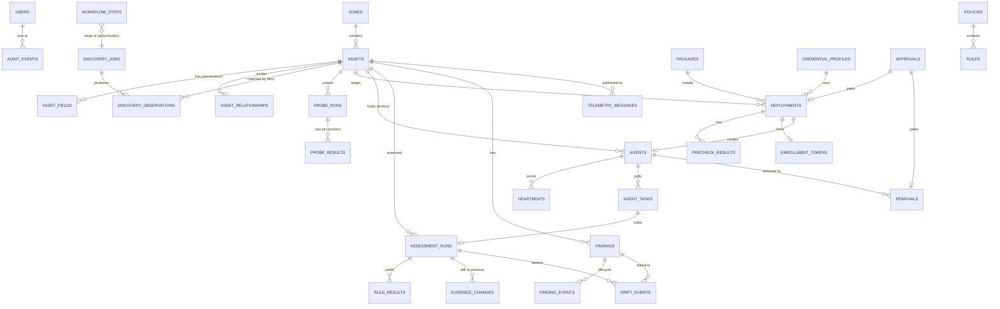

# Data model

SQLite through SQLAlchemy 2 (typed `Mapped[]` models) and Alembic migrations. All IDs are UUIDv7 strings (they sort by
time). All timestamps are UTC. JSON columns use SQLAlchemy `JSON`. Every mutable "head" row has a `version` column
for optimistic locking (`409 conflict` on a stale write).

Two table families (see [ARCHITECTURE.md §4](ARCHITECTURE.md#4-the-simulation-boundary)):

- **`sim_*`**: the simulated world. Business services never read these tables.
- **everything else**: OTProbe's own knowledge and workflow state.

## 1. ERD (OTProbe knowledge)

## 2. Tables

### Identity and configuration

| Table | Key columns | Notes |
|---|---|---|
| `users` | id, username UQ, display_name, role (`OPERATOR`/`APPROVER`/`ADMIN`), password_hash, active | Seed: operator/approver/admin (passwords in `.env.example`, demo only) |
| `zones` | id, name, cidr UQ, default_level, safe_mode, conduit_id | Seed per SIMULATED_NETWORK §1 |
| `settings` | key PK, value JSON, updated_by, updated_at | e.g. assessment interval override, criticality defaults |
| `credential_profiles` | id, name UQ (`OT-WINDOWS-READONLY`, `OT-WINDOWS-INSTALLER`, `OT-SNMPV3-RO`, `OT-LINUX-SSH-RO`), protocol, username, secret_ciphertext, description, rotated_at | Secret encrypted with Fernet using `VAULT_KEY` from env. The API returns only masked values |
| `packages` | id, name, version, architecture (`x64`), sha256, size_bytes, supported_os JSON, status (`ACTIVE`/`DEPRECATED`/`BLOCKED`), created_at, release_notes | Seed: Probe Agent 1.0.0 (DEPRECATED), 1.1.0 (ACTIVE) |
| `policies` | id, name UQ, version, source_file, digest, loaded_at | Loaded from `/rules/*.yaml` at startup. Digest changes create a new version |
| `rules` | id, policy_id, rule_id (`WIN-FW-001`), version, definition JSON, digest | UQ(policy_id, rule_id, version) — results always reference the exact version used |

### Inventory and provenance

| Table | Key columns | Notes |
|---|---|---|
| `assets` | id, **mac UQ**, ip, display_name, hostname, device_type, os_name, level, criticality, criticality_source (`DERIVED`/`MANUAL`), status (`ONLINE`/`OFFLINE`/`UNREACHABLE`/`UNKNOWN`), is_rogue, agent_state, eligibility (`ELIGIBLE`/`REVIEW_REQUIRED`/`NOT_SUPPORTED`/`NOT_ELIGIBLE`/`UNKNOWN`), eligibility_reason, classification JSON, current_agent_id, zone_id, first_seen, last_seen, last_probe_at, version | Denormalised "effective" columns for fast tables. They are recomputed from `asset_fields` by `ProvenanceService.refresh_asset()` and never written directly |
| `asset_fields` | id, asset_id, **field_path** (`os.build`), value JSON, **source** (`ARP`/`ICMP`/`SNMP`/`WinRM`/`WMI`/`SSH`/`MQTT`/`DEEP_AGENT`), **stage** (`DISCOVERY`/`AGENTLESS`/`DEEP`), **collected_at**, run_kind, run_id | UQ(asset_id, field_path, source). Effective value = see PROVENANCE §3 |
| `asset_relationships` | id, src_asset_id, dst_asset_id, protocol, port, source, first_seen, last_seen | UQ(src, dst, protocol, port) |
| `discovery_jobs` | id, targets JSON, methods JSON, safe_mode, status, progress (0–100), phase, devices_found, new_assets, rogue_count, requested_by, error, correlation_id, created/started/finished_at | |
| `discovery_observations` | id, job_id, asset_id, ip, mac, method, result JSON, observed_at | Raw per-method observation, the evidence for the merge |
| `probe_runs` | id, asset_id, status, requested_by, credential_profile_ids JSON, classification JSON (`type, confidence, evidence[]`), eligibility, eligibility_reason, error, correlation_id, started/finished_at | |
| `probe_results` | id, probe_run_id, protocol, ok, raw JSON, latency_ms, collected_at | Raw payload as returned by the adapter |
| `workflow_steps` | id, workflow_kind (`DISCOVERY`/`PROBE`/`PRECHECK`/`DEPLOY`/`REMOVAL`/`ASSESSMENT`), workflow_id, seq, name, status (`PENDING`/`RUNNING`/`OK`/`FAILED`/`SKIPPED`), detail, progress, data JSON, started_at, finished_at | Shared by all long-running workflows. Drives the live step lists in the UI |

### Approvals, deployment, agents

| Table | Key columns | Notes |
|---|---|---|
| `approvals` | id, subject_kind (`DEPLOYMENT`/`REMOVAL`), subject_id, requested_by, target_asset_id, purpose, criticality, maint_window_start, maint_window_end, decision (`PENDING`/`APPROVED`/`REJECTED`), decided_by, decided_at, reason | CHECK decided_by ≠ requested_by (also enforced in the service, which writes the audit event) |
| `deployments` | id, asset_id, package_id, credential_profile_id, status, purpose, requested_by, approval_id, precheck_run_no, agent_id, failure_code, failure_detail, retry_of_id, correlation_id, timestamps per phase, version | |
| `precheck_results` | id, deployment_id, run_no, check (`REACHABLE`/`HOSTNAME_VERIFIED`/`WINRM_AVAILABLE`/`AUTHENTICATION`/`PACKAGE_COMPATIBLE`/`DISK_SPACE`/`EXISTING_AGENT`/`SERVER_CONNECTIVITY`/`REBOOT_REQUIRED`), status (`PASS`/`FAIL`/`WARN`), detail, checked_at | Results of every precheck run are kept |
| `enrollment_tokens` | id, token_hash UQ, asset_id, deployment_id, expires_at, used_at, revoked_at | Plaintext exists only in the simulated install bundle on the virtual host |
| `agents` | id, asset_id, deployment_id, status, version, credential_hash UQ, credential_prefix, host_fingerprint, enrolled_at, last_heartbeat_at, missed_heartbeats, revoked_at, removed_at, version_lock | A new row per install. Never deleted |
| `heartbeats` | id, agent_id, seq, received_at, agent_time, payload JSON (cpu, mem, queueDepth, agentVersion, lastTaskId) | |
| `agent_tasks` | id, agent_id, kind (`RUN_ASSESSMENT`), payload JSON (policy, collectors, correlationId), status (`QUEUED`/`DISPATCHED`/`COMPLETED`/`FAILED`/`TIMED_OUT`/`CANCELLED`), assessment_run_id, dispatched_at, deadline_at, completed_at | |
| `removals` | id, asset_id, agent_id, status, requested_by, approval_id, failure_code, failure_detail, correlation_id, timestamps | |

### Assessment and findings

| Table | Key columns | Notes |
|---|---|---|
| `assessment_runs` | id, asset_id, agent_id NULL, policy_id, policy_version, source (`DEEP_AGENT`/`AGENTLESS`), trigger (`MANUAL`/`SCHEDULED`/`PROBE`), status (`QUEUED`/`RUNNING`/`EVALUATED`/`FAILED`/`TIMED_OUT`), evidence JSON (normalised document), score, counts JSON (`pass, fail, warning, unknown`), previous_run_id, correlation_id, started/finished_at | Evidence is kept as one document per run, so drift is a document diff |
| `rule_results` | id, run_id, rule_id, rule_version, status (`PASS`/`FAIL`/`WARNING`/`UNKNOWN`), severity, evidence_path, observed JSON, expected, message | |
| `evidence_changes` | id, asset_id, run_id, previous_run_id, path, before JSON, after JSON | "Configuration changes" on the dashboard |
| `findings` | id, **asset_id, rule_id** (UQ), title, severity, status (`OPEN`/`RESOLVED`/`REOPENED`/`ACCEPTED_RISK`), source (`DEEP_AGENT`/`AGENTLESS`/`TELEMETRY`), observed, expected, references JSON, first_seen, last_seen, resolved_at, reopen_count, accepted_by, accepted_reason, accepted_at, last_run_id, version | Deduplicated per asset+rule |
| `finding_events` | id, finding_id, from_status, to_status, run_id, actor, reason, at | Lifecycle history |
| `drift_events` | id, asset_id, run_id, previous_run_id, rule_id, from_status, to_status, evidence_path, before, after, finding_id, detected_at | Emitted as `CONFIGURATION_DRIFT_DETECTED` |
| `telemetry_messages` | id, topic, client_id, asset_id NULL, payload JSON, received_at | Bounded: keep the last 10,000, older ones roll up into `telemetry_rollups` (per topic, per minute min/avg/max) |

### Cross-cutting

| Table | Key columns | Notes |
|---|---|---|
| `audit_events` | id, seq UQ, at, actor_type (`USER`/`AGENT`/`SYSTEM`/`SIMULATOR`), actor_id, actor_name, action (event name, e.g. `DEPLOYMENT_APPROVED`), entity_kind, entity_id, correlation_id, details JSON, prev_hash, hash | **Append-only**. `hash = sha256(prev_hash + canonical_json(row))` makes it tamper-evident. `GET /audit/verify` checks the chain |
| `idempotency_keys` | (user_or_principal, key) PK, method, path, request_hash, status_code, response JSON, created_at | 24 h TTL |

## 3. Simulated world tables (`sim_*`)

| Table | Contents |
|---|---|
| `sim_devices` | device_id PK, ip, mac, hostname, vendor, model, type, level, powered, **state JSON** (capabilities, os, hardware, software, services, patches, firewall, antivirus, local_admins, password_policy, audit, usb, nics, listening, relationships, files) |
| `sim_faults` | device_id, fault (enum from FAILURE_MATRIX), params JSON, set_by, set_at. A global fault has device_id `*` |
| `sim_mqtt_clients` | client_id, device_id, source_ip, connected, topics JSON |
| `sim_meta` | key/value: seed version, rogue counter, last reset |

## 4. Retention rules

- **Never deleted, except by Reset POC:** `audit_events`, `assessment_runs`, `rule_results`, `findings`,
  `finding_events`, `drift_events`, `evidence_changes`, `deployments`, `precheck_results`, `approvals`,
  `removals`, `agents`, `agent_tasks`, `heartbeats`, `probe_runs`, `probe_results`, `discovery_jobs`.
- Removing an agent sets `agents.status=REMOVED`, `revoked_at` and `removed_at`. The row and all its history
  stay.
- `telemetry_messages` is the only table that rolls up automatically (see above).
- Reset POC: see [STATE_MACHINES.md §7](STATE_MACHINES.md#7-reset-poc). `audit_events` is **kept** across a
  reset, and a `POC_RESET` event is appended (decision Q2, accepted).
