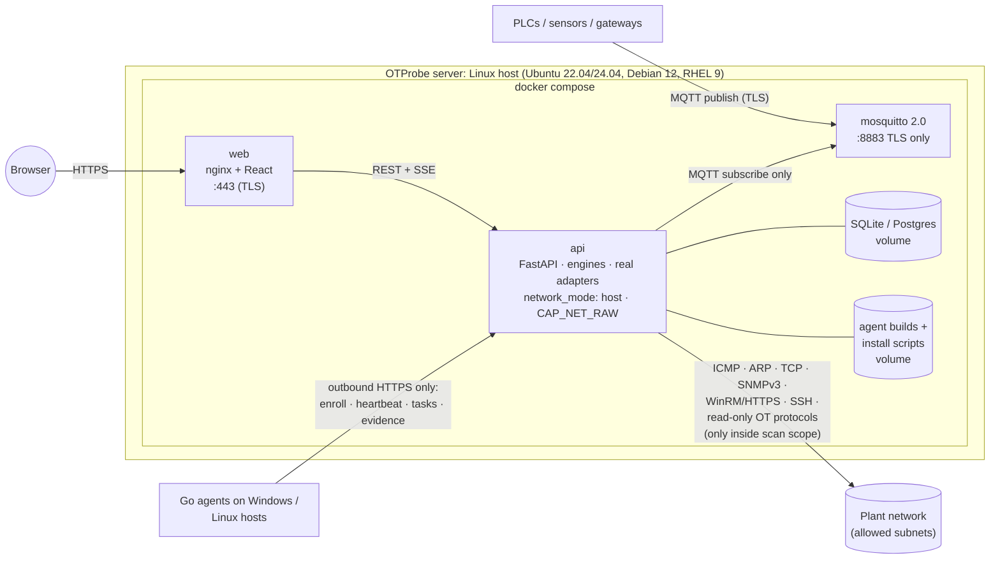
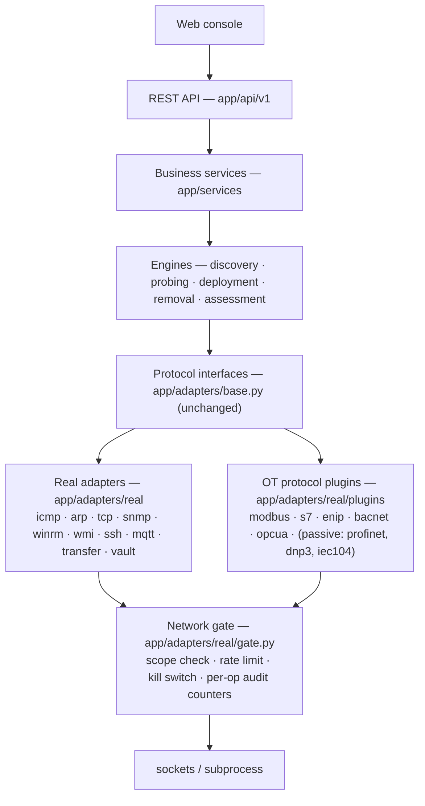
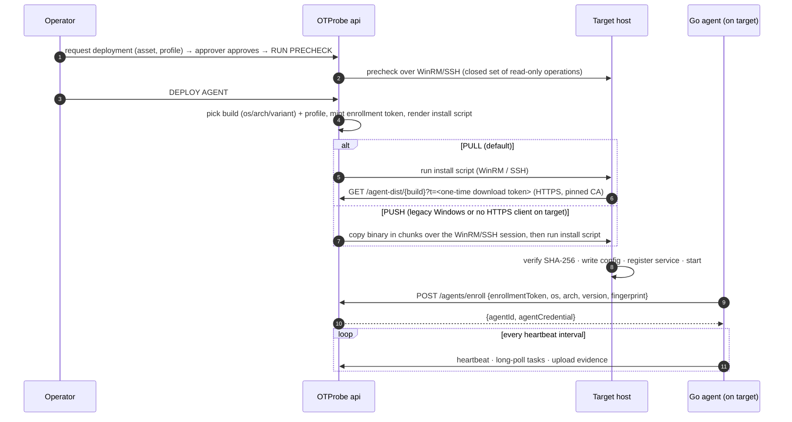

# OTProbe Live: Architecture

> Status: **design, phase L1 (for review)**. No code has been written for this yet.
>
> OTProbe Live takes the completed simulated POC (preserved on the `simulated` branch) and runs it against
> **real networks and real devices**. The console, API, database, workflows, approvals, rule engine, findings,
> drift and audit trail carry over unchanged. Three things change:
>
> - the **adapters** become real;
> - the **agent** becomes a Go binary, installed by script;
> - the **MQTT broker** becomes a bundled Mosquitto.

Related design documents:

| Document | Contents |
|---|---|
| [SAFETY_AND_SCOPE.md](SAFETY_AND_SCOPE.md) | Scan scope, network gate, safe mode, kill switch, read-only guarantees |
| [LIVE_PROTOCOLS.md](LIVE_PROTOCOLS.md) | Real adapters (ICMP, ARP, TCP, SNMP, WinRM/WMI, SSH) and the read-only OT protocol plugins |
| [GO_AGENT.md](GO_AGENT.md) | Go agent: builds per OS/arch, profiles, collectors, install/uninstall scripts, enrollment |
| [MQTT_BROKER.md](MQTT_BROKER.md) | Bundled Mosquitto: TLS, accounts, ACLs, topic → asset mapping, broker posture checks |
| [LIVE_TEST_PLAN.md](LIVE_TEST_PLAN.md) | Four test stages, lab topology, acceptance criteria, real failure injection |
| [DECISIONS.md](DECISIONS.md) | Section "Live network redesign": decisions agreed so far, and open questions |

Existing documents that stay valid: [RULES.md](RULES.md), [STATE_MACHINES.md](STATE_MACHINES.md),
[PROVENANCE.md](PROVENANCE.md), [DATA_MODEL.md](DATA_MODEL.md) (with the changes in §6 below).
[SIMULATED_NETWORK.md](SIMULATED_NETWORK.md), [FAILURE_MATRIX.md](FAILURE_MATRIX.md) and the demo/testing guides
move to the `simulated` branch only.

---

## 1. Branches

| Branch | Contents | Purpose |
|---|---|---|
| `simulated` | The finished POC as of commit `e824f55`, frozen | Demos, training, and a reference for workflow behaviour |
| `main` | OTProbe Live (after review, merged from `real-network`) | Real-network product |
| `real-network` | Work in progress for phases L1–L6 | Merged into `main` after each approved phase |

`main` contains **no simulator**: no `app/sim`, no `sim_*` tables, no `/sim/v1`, no Demo Controls, no
`agent-runtime` or `telemetry-sim`. The adapter registry keeps its interface, so a test fake can still be
registered inside the test suite (see [LIVE_TEST_PLAN.md](LIVE_TEST_PLAN.md) §2).

---

## 2. Runtime view (Linux host)



| Component | Runs as | Responsibility |
|---|---|---|
| `web` | nginx in a container, TLS on 443 | Console. Proxies `/api`. |
| `api` | uvicorn in a container with **host networking** and `CAP_NET_RAW` only (needed for ICMP and ARP) | API, engines, real adapters, network gate, job runner, SSE hub, watchdogs, MQTT subscriber, agent download endpoint |
| `mosquitto` | Official `eclipse-mosquitto:2.0.x` image (pinned) | Plant telemetry broker. See [MQTT_BROKER.md](MQTT_BROKER.md) |
| Go agent | Windows service / systemd unit **on the target host** | Collects evidence locally and sends it to `api`. Never listens on a port |

**Why host networking:** Docker's default bridge network hides layer 2. That breaks ARP and makes the scanner's
source address the Docker NAT. With `network_mode: host` the scanner uses the Linux host's own interfaces, which
is what firewall rules on the plant side will expect. The same compose file also runs without Docker: a
`systemd` install mode is documented for sites that do not allow containers.

---

## 3. Layering

The layering from the POC is kept. The simulated layer is replaced by real adapters and one new chokepoint, the
**network gate**.



New import-linter contracts:

| Module | May import | Must NOT import |
|---|---|---|
| `app.adapters.real.*` (except `gate`) | `app.adapters.base`, `app.adapters.real.gate`, `app.core` | `socket`, `asyncio.open_connection`, `subprocess`, network libraries directly |
| `app.adapters.real.gate` | `socket`, `asyncio`, network libraries | `app.services`, `app.engines` |
| `app.engines`, `app.services` | as today | `app.adapters.real.*` (registry only) |

Network libraries (`pysnmp`, `pypsrp`, `asyncssh`, `pymodbus`, …) are reached only through **factories in the
gate**. The gate hands them an already-checked target and a socket or transport that it opened itself. A CI test
fails the build if any other module imports a networking primitive. This mirrors the POC's
"simulated adapters cannot do network I/O" test, turned around: only one module may.

---

## 4. What changes, what stays

| Area | POC (`simulated`) | Live (`main`) |
|---|---|---|
| Console, API, auth, RBAC, approvals, self-approval rule | REAL | **unchanged** |
| Workflows and state machines | REAL | unchanged. Deployment steps are renamed to match real transport (see §5) |
| Rule engine, scoring, findings, drift, audit | REAL | unchanged. New Linux baseline and new rules (see [GO_AGENT.md](GO_AGENT.md) §7) |
| Discovery | simulated ICMP/ARP | Real ICMP sweep, ARP (kernel neighbour table, active ARP on local segments, SNMP ARP tables for remote segments) and TCP connect on a fixed port list |
| Agentless probing | simulated SNMP/WinRM/WMI/SSH | `pysnmp` v3, `pypsrp` (WinRM HTTPS), `asyncssh`, plus OT protocol plugins |
| Classification | rules on simulated fields | **same rules file**, extended with signals from the plugins (vendor, product code, protocol presence) |
| Agent | Python process reading `/sim` state | **Go binary** on the real host, reading the real OS |
| Deployment | simulated WinRM writes to `sim_devices` | Generated `install.ps1` / `install.sh`, run over WinRM / SSH, or copied by hand |
| Package | generated blob, real hash | Real signed binaries per OS/arch, `SHA256SUMS`, served over HTTPS |
| Vault | synthetic secrets | **Real** secrets, Fernet-encrypted, key file outside the DB, write-only through the API, never logged |
| MQTT | in-process broker + telemetry-sim | Bundled Mosquitto, TLS, ACLs. OTProbe subscribes only |
| Demo Controls, failure injection, Reset POC | yes | **removed**. Admin keeps "Clear inventory" (audited, typed confirmation) |
| Banner | `SIMULATED ENVIRONMENT - NO REAL DEVICES ARE BEING SCANNED` | `LIVE NETWORK — scope: 10.20.0.0/24, 10.20.1.0/24` (red). When no scope is configured: `LIVE NETWORK — NO SCAN SCOPE CONFIGURED (scanning disabled)` |
| Response header | `X-OTProbe-Environment: SIMULATED` | `X-OTProbe-Environment: LIVE` |

---

## 5. Deployment flow (real)



Deployment steps (`workflow_steps`, kind `DEPLOY`):

`CONNECT → OPEN_SESSION (WINRM | SSH) → RETRIEVE_CREDENTIAL → SELECT_BUILD → STAGE_PACKAGE (PULL | PUSH, progress %) →
VERIFY_HASH → INSTALL → START_SERVICE → WAIT_ENROLLMENT`

The state machine in [STATE_MACHINES.md](STATE_MACHINES.md) §2 is unchanged. The enrollment-race fix
(`complete_enrollment` on every heartbeat) carries over as is.

**Manual install.** For hosts that OTProbe cannot reach over WinRM or SSH, the deployment page shows a one-time
command, valid for 15 minutes and bound to that deployment and asset:

```powershell
# Windows
powershell -ExecutionPolicy Bypass -c "iwr https://otprobe.example/i/7Kq2…/install.ps1 -UseBasicParsing | iex"
```
```sh
# Linux
curl -fsS --cacert otprobe-ca.pem https://otprobe.example/i/7Kq2…/install.sh | sudo sh
```

A manual install still needs an approved deployment. It skips `CONNECT…STAGE_PACKAGE` and goes straight to
`WAIT_ENROLLMENT`.

---

## 6. Data model changes

| Change | Table | Notes |
|---|---|---|
| **Drop** | `sim_devices`, `sim_faults`, `sim_mqtt_clients`, `sim_meta` | Migration `0005_live` on `main` only |
| **New** | `scan_scopes` | `id, cidr, kind (INCLUDE/EXCLUDE), profile (IT/OT_SENSITIVE), label, created_by, created_at, disabled_at` |
| **New** | `safety_state` | Single row: `armed, stopped_by, stopped_at, reason` (kill switch) |
| **New** | `agent_builds` | `id, version, os, arch, variant (MODERN/LEGACY), sha256, size, signed, path, released_at` |
| **New** | `agent_profiles` | `id (windows-workstation, …), os, collectors[], policy_id` (seeded from `/rules/agent_profiles.yaml`) |
| **New** | `telemetry_sources` | `id, topic_filter, asset_id, metric, unit, payload_format (JSON_PATH/PLAIN/SPARKPLUG_B), json_path` |
| **New** | `mqtt_accounts` | `username, role (OTPROBE_READER/PUBLISHER/AGENT), acl[], password_hash (mosquitto PBKDF2), disabled_at` |
| **New** | `download_tokens` | One-time agent download / manual-install tokens (hashed, TTL, bound to deployment) |
| **Change** | `packages` | Replaced by `agent_builds` (packages table kept as a view for the existing API) |
| **Change** | `agents` | `+ os, arch, variant, profile_id, agent_version, host_fingerprint` |
| **Change** | `deployments` | `+ transfer_mode (PULL/PUSH/MANUAL), build_id, profile_id` |
| **Change** | `discovery_observations` | `+ method` gains values `TCP_CONNECT`, `PLUGIN:<name>`, `SNMP_ARP_TABLE` |

---

## 7. API changes

New, all admin-only unless stated, all audited:

| Endpoint | Purpose |
|---|---|
| `GET/POST/PATCH/DELETE /api/v1/scope` | Scan scope entries |
| `GET /api/v1/safety` (all roles) · `POST /api/v1/safety/stop` (operator+) · `POST /api/v1/safety/rearm` (admin) | Kill switch |
| `GET /api/v1/agent-builds` (all roles) · `POST /api/v1/agent-builds` (admin, upload) | Agent binaries per OS/arch |
| `GET /api/v1/agent-profiles` | Profiles and their collectors |
| `GET/POST/PATCH/DELETE /api/v1/telemetry/sources` | Topic → asset mappings |
| `GET/POST/PATCH/DELETE /api/v1/mqtt/accounts` | Broker accounts (password returned **once** on create) |
| `POST /api/v1/deployments/{id}/manual-install` | Issue a one-time install command |
| `GET /agent-dist/{buildId}?t=…` (download token) · `GET /i/{token}/install.{ps1,sh}` | Agent and script download |

Agent-facing endpoints (`/agents/enroll`, heartbeat, tasks, evidence) keep their shape. Enroll gains
`os, arch, variant, agentVersion, hostFingerprint`.

**Removed:** `/sim/v1/*`, `/api/v1/demo/*`.

---

## 8. Configuration (env)

| Var | Default | Meaning |
|---|---|---|
| `OTPROBE_PUBLIC_URL` | — (required) | URL that agents and install scripts use, e.g. `https://otprobe.plant.local` |
| `OTPROBE_TLS_CERT`, `OTPROBE_TLS_KEY` | generated self-signed CA + server cert on first start | Server TLS. The CA fingerprint is pinned into every agent config |
| `VAULT_KEY` / `VAULT_KEY_FILE` | generated `otprobe-vault.key` (0400) | Fernet key for the credential vault. Never in the DB |
| `OTPROBE_{ADMIN,OPERATOR,APPROVER}_PASSWORD` | generated, printed once in the log | First-start account passwords (≥ 12 characters) |
| `SAFE_MODE` | `true` | See [SAFETY_AND_SCOPE.md](SAFETY_AND_SCOPE.md) §4 |
| `SCAN_MAX_PPS` | `50` | Global packets-per-second ceiling for active discovery |
| `HEARTBEAT_INTERVAL_SEC`, `ASSESSMENT_INTERVAL_SEC`, `ENROLLMENT_*` | as POC | |
| `MQTT_URL` | `mqtts://mosquitto:8883` | Bundled broker |
| `DATABASE_URL` | `sqlite:////data/otprobe.db` | Postgres supported for larger sites |

Removed: `SPEED_FACTOR`, `SEED`, `SIM_SERVICE_TOKEN`, `ADAPTER_MODE` (always `real` on `main`).

---

## 9. Implementation phases (after this design is approved)

Each phase ends with a review stop, as before.

| Phase | Scope | Tested by |
|---|---|---|
| **L1** | This design | Review |
| **L2** ✅ | Scan scope + network gate + kill switch + safe mode, real ICMP / ARP (neighbour cache) / TCP / SNMP, live discovery and probe, credential vault admin, live banner and console. Live mode is the default; the simulator stays loadable for the test suite until L6 (DECISIONS.md L2-1) | Unit + live loopback tests; lab discovery |
| **L3** ✅ | Agentless: WinRM/WMI (read-only), SSH (read-only, host-key pinning), OT identification plugins (Modbus, S7, EtherNet/IP, BACnet, OPC UA, web title), classification signals, plugin selection per scope entry | Live tests against real Modbus/OPC UA/SSH/TLS servers and recording fake S7/ENIP/BACnet devices; Windows on a lab host |
| **L4** ✅ | Go agent (Windows, Linux, macOS; legacy Windows/Linux builds on Go 1.20), signed release pipeline and verification, WinRM install/uninstall, real deployment, enrollment over pinned TLS, removal and restart. Manual one-liner install and Linux deployment over SSH moved to L6 | Go unit tests; the real Go agent through the deployment workflow on 127.0.0.1; Windows laptop by hand (docs/TESTING_L4.md) |
| **L5** | Real assessments, Linux baseline, drift. Bundled Mosquitto, telemetry sources, broker checks | Lab |
| **L6** | Simulator moved out of `app/` into the test suite; full lab campaign (acceptance + failure matrix), packet-capture verification, docs, pilot runbook | [LIVE_TEST_PLAN.md](LIVE_TEST_PLAN.md) |
