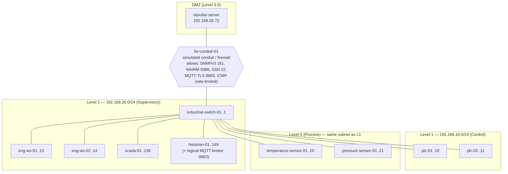

# Simulated network

> Everything in this file describes the **simulated world** (`sim_*` tables, `app/sim/seed.py`).
> No address below is ever contacted. Vendor and model strings are demo labels. Strings that resemble real
> vendors carry the suffix `(demo data)`.

The seed runs on first start and is **idempotent**: it upserts by `deviceId`. Reset POC replays it from scratch.
Values marked ★ are relied on by acceptance tests. Change them only together with the tests.

## 1. Zones and topology

| Zone | Subnet | Default level | Discovery safe mode |
|---|---|---|---|
| DMZ | 192.168.35.0/24 | 3.5 | n/a (server only, never scanned) |
| Supervisory | 192.168.20.0/24 | 2 | Off (normal rate) |
| Control / Process | 192.168.10.0/24 | 1 (refined to 0 by classification) | **On**: passive ARP, ICMP ≤ 1 pkt/s, SNMP GET-only with a read-only profile, no WinRM/WMI writes |

The topology view renders the zones as compound nodes, with the conduit as a distinct node between DMZ and L2.
The view comes from `GET /api/v1/topology`, which is built from **OTProbe's** knowledge (assets + observed
relationships) plus the static zone/conduit config. Simulator ground truth is not used.

## 2. Devices

MAC pattern: `00:1A:2B:3C:<third octet>:<last octet as two digits>` (for example .13 → `00:1A:2B:3C:20:13`).
For .139 and .149 the pattern uses `21:39` and `21:49`. The OUI `00:1A:2B` is a demo value and is not resolved to a
vendor.

| deviceId | IP ★ | MAC ★ | Hostname ★ | Type | Level | Vendor / model (demo) | OS / FW |
|---|---|---|---|---|---|---|---|
| dev-server | 192.168.35.72 | 00:1A:2B:3C:35:72 | otprobe-server | Probe Server | DMZ | OTProbe | Linux (container) |
| dev-sw01 | 192.168.20.1 | 00:1A:2B:3C:20:01 | industrial-switch-01 | Switch | 2 | IndustrialNet IMS-2400 (demo data) | IMS-OS 5.4.2 |
| dev-ews01 | 192.168.20.13 | 00:1A:2B:3C:20:13 | eng-ws-01 | Engineering Workstation | 2 | Dell-style Precision 3660 (demo data) | Windows 11 Enterprise 24H2, build 26100.2314 |
| dev-ews02 | 192.168.20.14 | 00:1A:2B:3C:20:14 | eng-ws-02 | Engineering Workstation | 2 | HP-style Z2 G5 (demo data) | Windows 10 Enterprise 22H2, build 19045.3803 |
| dev-scada01 | 192.168.20.139 | 00:1A:2B:3C:21:39 | scada-01 | SCADA Server | 2 | Dell-style PowerEdge R650 (demo data) | Windows Server 2019 Standard, build 17763.5329 |
| dev-hist01 | 192.168.20.149 | 00:1A:2B:3C:21:49 | historian-01 | Historian (Linux Server) | 2 | Generic x86 server (demo data) | Ubuntu 22.04.4 LTS |
| dev-plc01 | 192.168.10.10 | 00:1A:2B:3C:10:10 | plc-01 | PLC | 1 | Siemens-style S7-1500 Demo (demo data), CPU 1516-3 PN/DP | FW V2.9, mode RUN ★ |
| dev-plc02 | 192.168.10.11 | 00:1A:2B:3C:10:11 | plc-02 | PLC | 1 | Rockwell-style ControlLogix 5580 Demo (demo data) | FW 33.011, mode RUN |
| dev-ts01 | 192.168.10.20 | 00:1A:2B:3C:10:20 | temperature-sensor-01 | Sensor (temperature) | 0 | Generic IIoT PT100 transmitter (demo data) | FW 1.4.0 |
| dev-ps01 | 192.168.10.21 | 00:1A:2B:3C:10:21 | pressure-sensor-01 | Sensor (pressure) | 0 | Generic IIoT pressure transmitter (demo data) | FW 1.4.0 |

### 2.1 Protocol capability flags (seed)

| deviceId | ICMP | ARP | SNMP | WinRM 5986 | WMI/CIM | SSH | MQTT client | Notes |
|---|---|---|---|---|---|---|---|---|
| dev-sw01 | ONLINE | ✓ | v3 (OT-SNMPV3-RO) | — | — | — | — | sysName, uptime, 24 ifaces, 9 active ★ |
| dev-ews01 | ONLINE | ✓ | — | ✓ HTTPS, valid cert | ✓ | — | — | |
| dev-ews02 | ONLINE | ✓ | — | ✓ | ✓ | — | — | |
| dev-scada01 | HIGH_LATENCY (≈180 ms) | ✓ | — | ✓ | ✓ | — | — | |
| dev-hist01 | ONLINE | ✓ | v3 | — | — | ✓ (stub) | broker host | |
| dev-plc01 | ONLINE (safe-mode rate) | ✓ | v3 **read-only** | — | — | — | publishes `factory/line1/plc01/status` | |
| dev-plc02 | ONLINE (safe-mode rate) | ✓ | v3 **read-only** | — | — | — | — | |
| dev-ts01 | **BLOCKED** (ICMP disabled) ★ | ✓ ★ | none ★ | — | — | — | publishes `factory/line1/sensor01/temperature` | discoverable only via ARP (+ MQTT enrichment) |
| dev-ps01 | **BLOCKED** ★ | ✓ ★ | none ★ | — | — | — | publishes `factory/line1/sensor02/pressure` | same |

### 2.2 Host state for Windows machines (seed)

These values determine the first deep-assessment result (acceptance E). Each column header shows the evidence path.

| Evidence path | eng-ws-01 ★ | eng-ws-02 | scada-01 |
|---|---|---|---|
| `firewall.state` | `enabled` (Domain/Private/Public) → **PASS** | `enabled` | `enabled` |
| `antivirus.state` / `antivirus.product` | `running` / Microsoft Defender, sigs 1 day old → **PASS** | `running` | `running` |
| `patches.missing_count` / `patches.missing` | `2` (KB5048667, KB5050009 — demo IDs) → **FAIL HIGH** | `14` | `3` |
| `software.installed[]` | Siemens-style TIA Portal V18 (demo data), Notepad++, 7-Zip, **RemoteTool Demo 3.2** → **WARNING MEDIUM** | TIA Portal V16 (demo data) | WinCC-style SCADA Runtime (demo data) |
| `usb.storage_policy` | **absent** (registry key unreadable: "USB policy unverifiable") → **UNKNOWN** | `blocked` | `blocked` |
| `password_policy` | min length 14, complexity on, lockout 5, max age 90 → **PASS** | min 8 → FAIL | min 14 |
| `local_admins.members[]` | Administrator (disabled), DEMO\ot-admins, DEMO\eng-shared, eng-ws-01\support → 3 enabled > 2 → **FAIL MEDIUM** | 2 | 2 |
| `audit.logon_events` | `success_and_failure` → **PASS** | `success` | `success_and_failure` |
| `os.product` | Windows 11 Enterprise → **PASS** | Windows 10 Enterprise → **FAIL HIGH** (unsupported) | Windows Server 2019 |
| `services.running[]` | WinRM, Defender, EventLog, Spooler, … | … | … |
| `network.listening[]` | 135, 445, 3389, 5986 | 135, 445, 5986 | 135, 445, 5986, 4840 (OPC UA) |
| `agent.health` (deep only) | from agent self-check → **PASS** | | |

Seed hardware for eng-ws-01: Intel Core i7-12700 (demo), 32 GB RAM, 512 GB SSD with 318 GB free, uptime 6 d 4 h.
NICs: `Ethernet0` 192.168.20.13/24, gateway 192.168.20.254.

### 2.3 Agent eligibility (derived by OTProbe, not stored in the simulator)

Eligibility is **computed by OTProbe** from classification and criticality, using `rules/eligibility.yaml`. The
expected outcomes for the seed are:

| Asset | Eligibility | Reason |
|---|---|---|
| eng-ws-01, eng-ws-02 | `ELIGIBLE` | Windows engineering workstation with WinRM available |
| scada-01 | `REVIEW_REQUIRED` | Critical asset: deployment requires approver review and a maintenance window |
| historian-01 | `NOT_SUPPORTED` | Linux agent not supported in this POC. Agentless only (SSH/SNMP) |
| plc-01, plc-02 | `NOT_ELIGIBLE` | Traditional PLCs are handled agentless/read-only in this POC. ★ |
| sensors, switch | `NOT_ELIGIBLE` | Embedded / network device; agentless only |
| any asset not yet probed | `UNKNOWN` | Run an agentless probe to determine eligibility |

## 3. Communication relationships (observed via switch / SNMP / WMI netstat)

| From | To | Protocol / port |
|---|---|---|
| eng-ws-01 | plc-01 | S7comm 102/tcp |
| eng-ws-02 | plc-02 | EtherNet/IP 44818/tcp |
| scada-01 | plc-01, plc-02 | S7comm 102, EtherNet/IP 44818 |
| scada-01 | historian-01 | OPC UA 4840 → historian ingest 5450 |
| plc-01 | temperature-sensor-01, pressure-sensor-01 | PROFINET IO (L2) |
| plc-01, sensors | historian-01 (MQTT broker) | MQTT-TLS 8883 |
| otprobe-server | fw-conduit-01 → L2 | management (SNMPv3, WinRM, SSH, MQTT subscribe) |

Relationships appear in OTProbe only after they are observed: SNMP LLDP/FDB on the switch, WMI netstat on
Windows hosts, and MQTT client lists.

## 4. Protocol behaviour summary

| Protocol | Results | Failure modes (injectable) |
|---|---|---|
| ICMP | `ONLINE` / `OFFLINE` / `HIGH_LATENCY` / `TIMEOUT` / `BLOCKED` with RTT | device offline, ICMP blocked. The UI always shows: *"No ICMP reply does not mean the device is offline."* |
| ARP | IP–MAC pairs for a subnet, labelled `ARP` | device offline (stops after the ARP cache ages: 2 discovery cycles) |
| SNMPv3 | switch: sysName, sysDescr, sysUpTime, ifTable (24), activePorts (9), LLDP neighbours. PLC: vendor, model, firmware, mode | SNMP timeout, wrong credentials |
| WinRM | session stages `CONNECTING → TCP_OK → TLS_VALIDATED → AUTH_OK → SESSION_CREATED` | connection refused, wrong credentials, invalid certificate, WinRM disabled, timeout |
| WMI/CIM | OS, build, manufacturer, model, CPU, RAM, disk, firewall, Defender, installed apps (partial: top-level Uninstall keys only), services, hotfixes | inherits WinRM failures |
| SSH (stub) | hostname, `os-release`, kernel, uptime | not reachable |
| MQTT | broker clients (client ID, source IP), retained topics, live messages | PLC offline (status stops), sensor value overrides |

Telemetry defaults (deterministic from `SEED`): temperature 42.5 ± 1.5 °C every 5 s. Pressure 4.2 ± 0.2 bar every
5 s. PLC status `{"mode":"RUN","cycleMs":12,"cpuLoad":23}` every 10 s. Thresholds are rule data
(`rules/telemetry.yaml`).

## 5. Rogue device (injectable)

Demo Control "Inject rogue device" adds `dev-rogue-<n>` at `192.168.20.66`, MAC `DE:AD:BE:EF:20:66`, with ICMP
ONLINE and nothing else. On the next discovery of 192.168.20.0/24, its MAC is not in the inventory baseline. This
creates a `ROGUE` asset, the finding `NET-ROGUE-001` (HIGH) and the audit event `ROGUE_DEVICE_DETECTED`.
