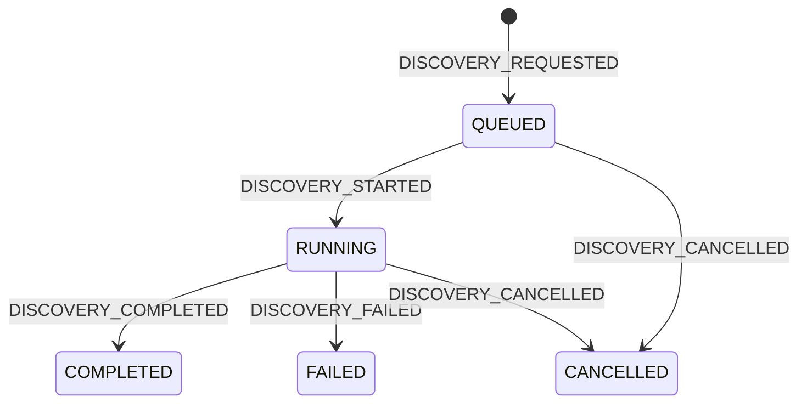
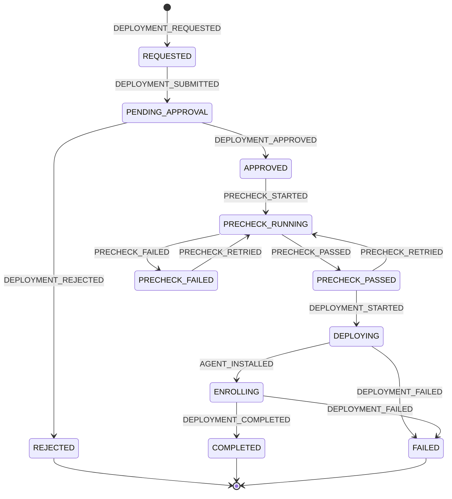
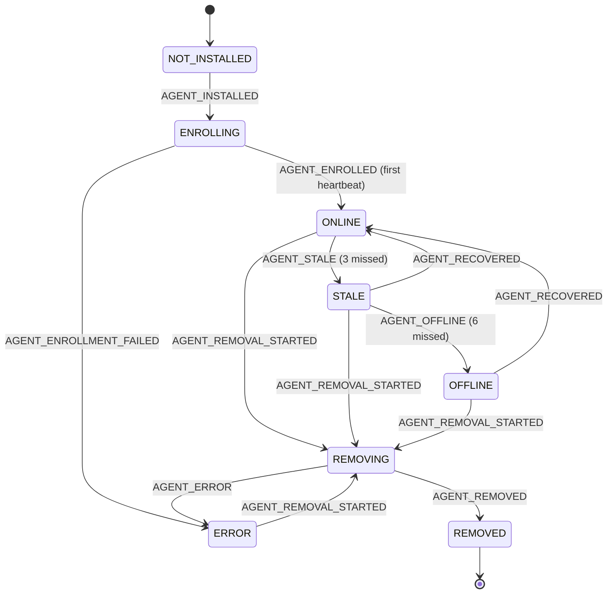
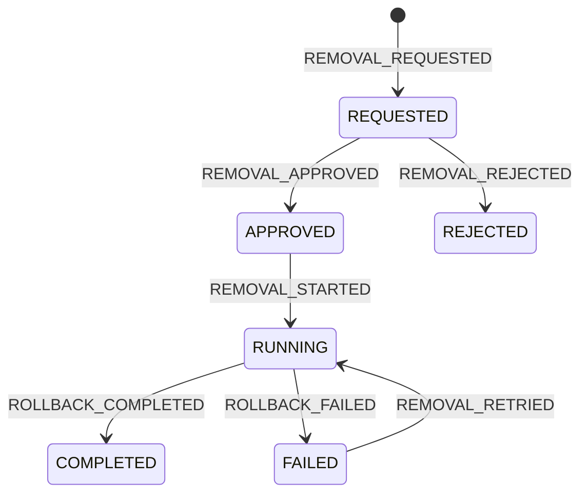
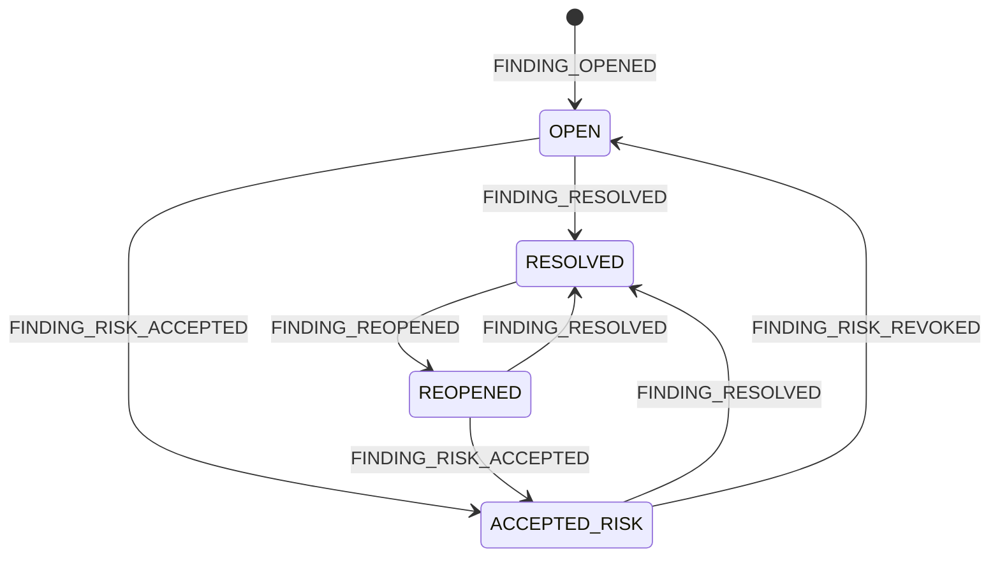

# State machines

Every machine is declared as data in `app/workflow/machines.py`, as `{(from, to): TransitionSpec(event, guard,
roles)}`. All changes go through `StateMachine.transition()`. That call:

1. rejects edges that are not declared, with `409 application/problem+json`, type `invalid-state-transition`
   (`detail: "Deployment 0192… cannot go from PENDING_APPROVAL to DEPLOYING"`),
2. evaluates the guard and the role check,
3. writes the new state, the audit event (actor, correlation ID, from, to, reason) and a `*_events` row where one
   exists, in **one transaction**,
4. publishes the SSE event after commit.

Unit tests enumerate the full Cartesian product of states for each machine. They assert that exactly the
declared edges are accepted.

---

## 1. Discovery job

Progress milestones (SSE `discovery.progress`): **10%** targets validated, safe-mode policy applied · **30%** ARP
sweep complete (devices appear one by one *during* this phase) · **60%** ICMP complete · **100%** SNMP identity
complete, merge done.

## 2. Deployment

| Edge | Guard |
|---|---|
| create | Asset eligibility ∈ {`ELIGIBLE`, `REVIEW_REQUIRED`} (otherwise `422 asset-not-eligible` with the reason). No active (non-terminal) deployment exists for the asset. No ONLINE/STALE/OFFLINE agent exists. Package `ACTIVE` |
| REQUESTED → PENDING_APPROVAL | Automatic. Creates the `approvals` row. `REVIEW_REQUIRED` assets need a maintenance window in the request |
| → APPROVED / REJECTED | Role approver/admin. **`actor ≠ requested_by`**, otherwise `403 self-approval-forbidden` + `APPROVAL_SELF_DENIED`. Reason required for REJECTED and for any REVIEW_REQUIRED asset |
| → DEPLOYING | Precheck PASSED within the last 30 min. Inside the maintenance window if one was set. Actor = requester or admin |
| ENROLLING → COMPLETED | First heartbeat from the agent enrolled with this deployment's token |
| ENROLLING → FAILED | Enrollment rejected, or no heartbeat within `ENROLLMENT_TIMEOUT_SEC` |

`FAILED` and `REJECTED` are terminal. **Retry** creates a new deployment with `retry_of_id` set, which needs a new
approval (decision Q3, accepted; see [DECISIONS.md](DECISIONS.md)).

The UI enables **Deploy Agent** only when `status == PRECHECK_PASSED`. The API enforces the same rule
independently.

### Deployment steps (`workflow_steps`, kind `DEPLOY`)

`CONNECT → WINRM_SESSION → RETRIEVE_CREDENTIAL → TRANSFER_PACKAGE (progress %) → VERIFY_HASH → INSTALL →
SERVICE_CREATED → START_SERVICE → AWAIT_ENROLLMENT`

### Precheck checks (kind `PRECHECK`)

`REACHABLE, HOSTNAME_VERIFIED, WINRM_AVAILABLE, AUTHENTICATION, PACKAGE_COMPATIBLE, DISK_SPACE (≥ 2 GB free),
EXISTING_AGENT (none present), SERVER_CONNECTIVITY (host → server :443 through the conduit), REBOOT_REQUIRED
(no pending reboot; WARN only)`. Each check returns PASS/FAIL/WARN with a detail string. Any FAIL →
`PRECHECK_FAILED`.

## 3. Agent

- The agent row is created by `AGENT_REGISTERED` when INSTALL succeeds. `AGENT_INSTALLED` is the deployment's
  DEPLOYING → ENROLLING event.
- `NOT_INSTALLED` is the **implicit** state of an asset that has no active agent row (`assets.agent_state`).
  An `agents` row is created when the INSTALL step succeeds, starting in `ENROLLING`. Because of this, a failed
  install leaves nothing behind ("nothing installed").
- Missed heartbeats: `missed = floor((now − last_heartbeat_at) / HEARTBEAT_INTERVAL_SEC)`. The heartbeat
  watchdog runs every interval. With the defaults, STALE comes after ≥ 30 s and OFFLINE after ≥ 60 s.
- On **REMOVING**, the credential is revoked as part of the removal steps. On **REMOVED**, `revoked_at` is always
  set.
- A reinstall after REMOVED creates a **new** agent row. The old one stays as history.

## 4. Removal (rollback)

`REJECTED` and `FAILED → RUNNING` (admin-only retry under the same approval) are **additions** to the brief.
Decision Q4, accepted.

Steps (kind `REMOVAL`): `STOP_ASSESSMENTS → CONNECT → STOP_AGENT → UNINSTALL → REVOKE_IDENTITY →
REMOVE_TEMP_FILES → VALIDATE_DEVICE → ROLLBACK_COMPLETED`.

**Fail-safe:** if any step fails, `REVOKE_IDENTITY` still runs as a compensation step before the removal goes to
`FAILED`, and the agent goes to `ERROR`. A half-removed agent can therefore never keep talking to the server. The
removal **never** deletes assessment runs, findings, deployments, heartbeats or audit events.

## 5. Finding

Driven by rule results for (asset, rule):

| Rule result | Finding absent | OPEN / REOPENED | RESOLVED | ACCEPTED_RISK |
|---|---|---|---|---|
| FAIL or WARNING | create **OPEN** | update `last_seen`, observed, severity | → **REOPENED** (`reopen_count++`) | update `last_seen` (stays accepted) |
| PASS | — | → **RESOLVED** | — | → **RESOLVED** |
| UNKNOWN | — | no change (missing evidence never resolves a finding) | no change | no change |

`ACCEPTED_RISK` is admin-only and needs a reason. It has an optional expiry; at expiry the finding goes back to
`OPEN`.

## 6. Supporting machines

| Machine | States |
|---|---|
| Probe run | `QUEUED → RUNNING → COMPLETED \| PARTIAL \| FAILED` (PARTIAL = some protocols failed; data still recorded) |
| Assessment run | `QUEUED → RUNNING → EVALUATED \| FAILED \| TIMED_OUT \| CANCELLED` (CANCELLED when the agent is removed mid-run) |
| Agent task | `QUEUED → DISPATCHED → COMPLETED \| FAILED \| TIMED_OUT \| CANCELLED` |
| Approval | `PENDING → APPROVED \| REJECTED`, and `PENDING → EXPIRED` if the requested maintenance window ends before a decision |

## 7. Reset POC

`POST /api/v1/demo/reset` (admin, `{"confirm": "RESET", "clearDiscoveryHistory": false}`):

1. Rejects the request while any workflow is running, unless `force=true`. With `force=true`, running workflows
   are cancelled first.
2. Revokes all agent credentials. The agent-runtime sees `401 agent-credential-revoked` and stops its agents.
3. Truncates the OTProbe knowledge tables. Discovery jobs/observations are kept if
   `clearDiscoveryHistory=false`. Users are kept.
4. Re-seeds `sim_*`, packages, vault profiles, zones and policies.
5. Appends `POC_RESET` to the **retained** audit log (decision Q2, accepted; see [DECISIONS.md](DECISIONS.md)).

Result: no agents installed. The only findings are "baseline" findings (decision Q1, accepted; see [DECISIONS.md](DECISIONS.md)).

## 8. Audit event catalogue (excerpt)

`AUTH_LOGIN, AUTH_LOGIN_FAILED, DISCOVERY_*, ASSET_CREATED, ASSET_IP_CHANGED, IP_MAC_CONFLICT,
ROGUE_DEVICE_DETECTED, ASSET_AUTHORIZED, PROBE_STARTED, PROBE_COMPLETED, PROBE_FAILED, ASSET_CLASSIFIED,
DEPLOYMENT_*, APPROVAL_SELF_DENIED, PRECHECK_*, CREDENTIAL_RETRIEVED, PACKAGE_TRANSFERRED, DEPLOY_HASH_FAIL,
DEPLOY_INSTALL_FAIL, AGENT_*, ENROLLMENT_TOKEN_ISSUED, ENROLLMENT_TOKEN_REJECTED, AGENT_CREDENTIAL_REVOKED,
AGENT_AUTH_REJECTED, ASSESSMENT_*, CONFIGURATION_DRIFT_DETECTED, FINDING_*, REMOVAL_*, ROLLBACK_*,
TELEMETRY_THRESHOLD_EXCEEDED, DEMO_CONTROL_APPLIED, POC_RESET, WORKFLOW_INTERRUPTED`. The full list is generated
into `docs/AUDIT_EVENTS.md` in Phase 2. Failure-specific names are in [FAILURE_MATRIX.md](FAILURE_MATRIX.md).
